# System Block Diagram

Deliverable 1 for the advisor review. Pin numbers are the **physical header pin numbers**
from the Build Guide ("Physical wiring map"), not BCM or GP numbers. This page is a
draft until the schematic in `hardware/` exists and a faculty check has signed the wiring.

## Diagram

```mermaid
flowchart LR
  subgraph ROVER["Rover node A"]
    IMU["MPU-6050 IMU<br/>(3.3 V, I2C)"]
    PA["Pico 2 A<br/>sampler + UART framing"]
    PIA["Raspberry Pi A<br/>persistent queue (microSD)<br/>TLS 1.3 client"]
  end
  AP(("Dedicated 2.4 GHz<br/>Wi-Fi AP"))
  subgraph RELAY["Relay node B"]
    PIB["Raspberry Pi B<br/>TLS 1.3 server<br/>durable dedup store (microSD)"]
    PB["Pico 2 B<br/>UART receive + display"]
    OLED["SSD1306 OLED<br/>128x64, I2C"]
  end
  IMU -- "I2C0 SDA GP4 / SCL GP5" --> PA
  PA -- "UART0 115200 8N1, 3.3 V, CRC-16 frames" --> PIA
  PIA -- "TLS 1.3 records (X25519MLKEM768 or X25519)" --> AP
  AP -- "Wi-Fi" --> PIB
  PIB -- "ACK after durable commit" --> AP
  PIB -- "UART0 115200 8N1, 3.3 V" --> PB
  PB -- "I2C0 SDA GP4 / SCL GP5" --> OLED
```

## What crosses each boundary

| Link | Medium | Protected by | Notes |
|------|--------|--------------|-------|
| IMU → Pico A | I2C | Nothing (on-board wiring) | Pull-ups and 3.3 V compatibility to be confirmed on the actual breakout |
| Pico A → Pi A | UART, 3.3 V | CRC-16 only | Trusted physical cable; **outside TLS** (see limits below) |
| Pi A → Pi B | Wi-Fi + TCP | TLS 1.3, certificate verified, pinned group | The only wireless hop |
| Pi B → Pico B | UART, 3.3 V | CRC-16 only | Trusted physical cable |
| Pico B → OLED | I2C | Nothing | |
| Pi A, Pi B | microSD | Filesystem | Persistent queue and dedup store, flushed before send and before ACK |

**Limits to state in the report.** Anyone with physical access to the UART cables or the
Pis can forge or read records there. TLS protects only the Wi-Fi hop. The claim is "secured
wireless link", not end-to-end sensor-to-display security.

## Wiring summary (from the Build Guide)

| From | To | Signal |
|------|----|--------|
| Pi A pin 8 (GPIO14 TX) | Pico A pin 2 (GP1, UART0 RX) | Pi → Pico |
| Pi A pin 10 (GPIO15 RX) | Pico A pin 1 (GP0, UART0 TX) | Pico → Pi |
| Pi A pin 6 (GND) | Pico A pin 3 (GND) | Common ground |
| Pico A pin 6 (GP4) | IMU SDA | I2C0 SDA |
| Pico A pin 7 (GP5) | IMU SCL | I2C0 SCL |
| Pico A pin 36 (3V3 OUT) | IMU VCC | Only if the breakout is 3.3 V-capable and the current budget allows |
| Pico A pin 38 (GND) | IMU GND | |
| Pi B pin 8 / 10 / 6 | Pico B pin 2 / 1 / 3 | Same three UART connections as Pi A |
| Pico B pin 6 (GP4) | OLED SDA | I2C0 SDA |
| Pico B pin 7 (GP5) | OLED SCL | I2C0 SCL |
| Pico B pin 36 (3V3 OUT) | OLED VCC | When compatible; verify current and pull-ups |
| Pico B pin 38 (GND) | OLED GND | |

Cross TX into RX, share ground, never power a load from a GPIO or the Pi header, and do
not rewire under power. Each node keeps its own power supply; no UART cable powers another
device. Test points to expose and label: UART TX, RX and ground on both links, and the
supply rails.

## Open items before this is final

- The MPU-6050 chip accepts only 2.375 to 3.46 V on its supply ([MPU-6050](research/mpu-6050.md)). Do not
  connect a bare chip to 5 V. Confirm what regulator and pull-ups the actual breakout has before wiring it to
  the Pico's 3.3 V pin.
- The OLED's I2C address is `0x3C` (SA0 low) or `0x3D` (SA0 high), and its charge pump makes the panel supply
  ([SSD1306](research/ssd1306.md)). Record the module's address and check its supply range.
- The RP2350's internal pull-ups (32 to 86 kohm) may be too weak for I2C; its datasheet says to fit external
  pull-ups ([RP2350](research/rp2350.md)). Check whether the IMU and OLED breakouts already have them.
- Pins and functions in the table above are confirmed against the official pinout
  ([Pico 2 pinout](research/pico-2-pinout.md)).
- Confirm whether each Pico is powered from its Pi's USB (Build Guide gate L1) or from a
  separate supply (the Build Guide's parts list has four supplies for four devices).
- Replace this page's diagram with the KiCad schematic and `hardware/pin_map.csv`.
- Add measurement points: where the scope or logic analyzer attaches, and where the
  current is measured (DMM in series on each Pi's supply, or a sensor if Q5 allows).
